# 🛒 Mercado Express: Spring Security MVC

**Checkpoint 5, Parte 1 (Spring Security MVC, Deploy e PostgreSQL)**
FIAP · Tecnologia em Análise e Desenvolvimento de Sistemas (TDS) · Java Advanced · Prof. Dr. Marcel Stefan Wagner

Aplicação web de um **mercado express** (hortifruti, limpeza, mercearia e vestuário) feita com **Spring Framework MVC** (Maven + Java 21), **Spring Security**, **Thymeleaf**, **Spring Data JPA**, **Lombok** e **PostgreSQL**. O sistema tem tela de login própria, cadastro (Sign Up), dois perfis de usuário com acessos diferentes e o CRUD completo de produtos.

| | |
|---|---|
| 🌐 **Deploy (produção)** | **https://mercado-express-security-er2t.onrender.com** (Render) |
| 💻 **IDE utilizada** | IntelliJ IDEA |
| 🗄️ **Banco de dados** | PostgreSQL (tabelas `TDS_Sec_MVC_TB_Mercado` e `TDS_Users_Mercado`) |
| ☁️ **Plataforma de deploy** | Render (Web Service Docker + PostgreSQL) |

> ⚠️ O plano gratuito do Render "dorme" quando fica sem acesso. O **primeiro acesso pode levar cerca de 50 segundos** para acordar.

### Contas de demonstração

| Perfil | E-mail | Senha | O que pode fazer |
|---|---|---|---|
| **ADMIN** (gerente) | `admin@mercadoexpress.com` | `admin123` | Painel admin, CRUD completo de produtos, gestão de usuários/perfis |
| **CLIENTE** | `cliente@mercadoexpress.com` | `cliente123` | Consultar o catálogo e o detalhe dos produtos |

Também é possível criar uma conta nova em **Cadastre-se**. Ela entra com o perfil CLIENTE.

---

## 📑 Sumário
1. [Integrantes](#-integrantes)
2. [Tecnologias e Spring Initializr](#-tecnologias-e-spring-initializr)
3. [Arquitetura](#-arquitetura)
4. [Modelo de dados](#-modelo-de-dados)
5. [Segurança: login, Sign Up e perfis](#-segurança-login-sign-up-e-perfis)
6. [Endpoints e rotas](#-endpoints-e-rotas)
7. [Passo a passo com prints](#-passo-a-passo-com-prints)
8. [Como executar localmente](#-como-executar-localmente)
9. [Deploy no Render](#-deploy-no-render)

---

## 👥 Integrantes

| Nome | RM |
|---|---|
| Erick Bernardes Bradaschia | RM565733 |
| Gabriel Santos Claudino | RM564054 |
| Jonathan Moreira Gomes | RM565060 |
| Kaiky de Oliveira Silva | RM566067 |
| Lucas Fortes de Lima | RM559523 |

Turma **2TDSR**, curso **TDS**.

---

## 🧰 Tecnologias e Spring Initializr

- Java 21 · Spring Boot 4.1.1 · Maven
- Spring Web MVC + Thymeleaf (+ `thymeleaf-extras-springsecurity`)
- Spring Security (form login customizado, BCrypt, autorização por perfil)
- Spring Data JPA + Hibernate · PostgreSQL
- Bean Validation · Lombok · DevTools
- Docker (deploy no Render)

**Configuração final do Spring Initializr** (Maven, Java 21, configuração YAML):

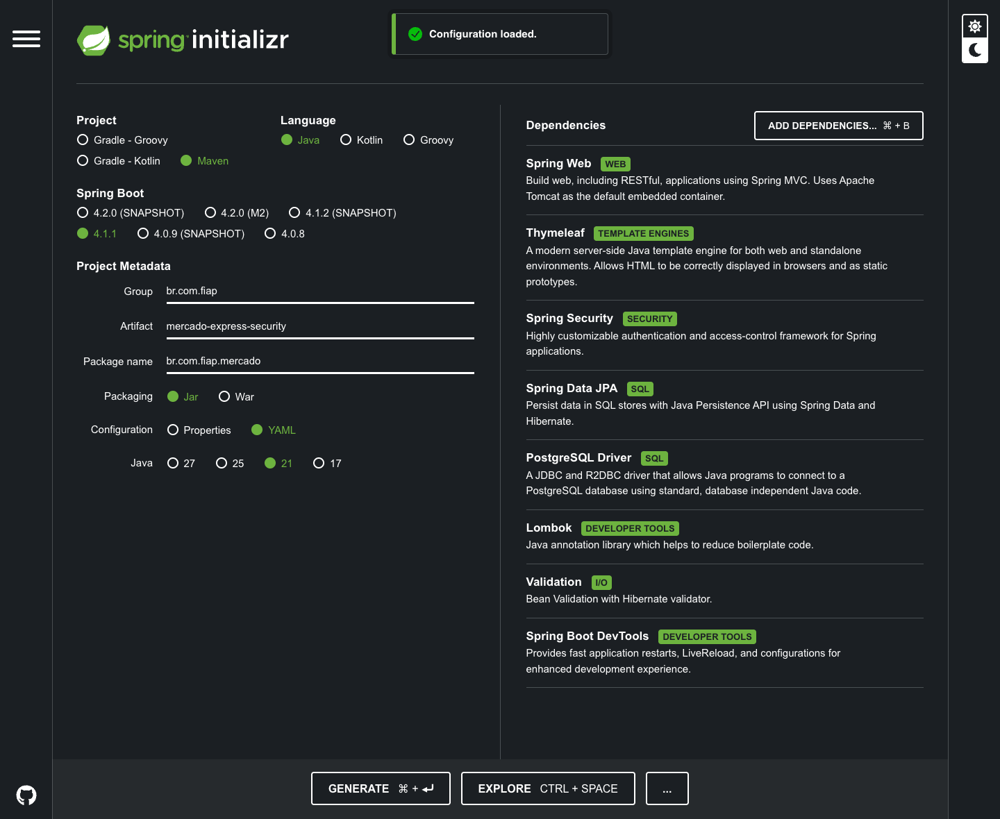

---

## 🏗️ Arquitetura

Padrão **MVC** em camadas: o navegador conversa com os *Controllers*, que usam os *Repositories* (Spring Data JPA) para acessar o PostgreSQL e devolvem as *Views* Thymeleaf. O **Spring Security** fica na frente de tudo, filtrando cada requisição.

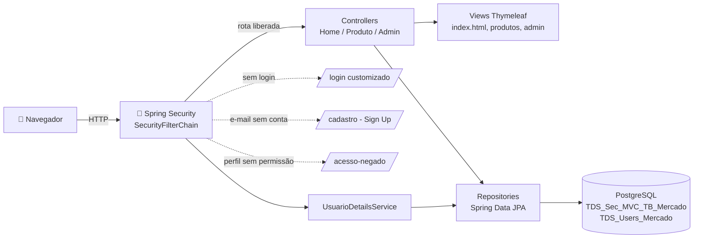

### Estrutura de pastas

```
src/main/java/br/com/fiap/mercado
├── config
│   ├── SecurityConfig.java       # regras de acesso, login customizado, handlers de sucesso/falha
│   └── DataLoader.java           # usuários demo (ADMIN/CLIENTE) + produtos iniciais
├── controller
│   ├── HomeController.java       # index, login, cadastro (Sign Up), acesso negado
│   ├── ProdutoController.java    # CRUD de produtos
│   └── AdminController.java      # painel admin e gestão de perfis
├── model                         # Produto, Usuario, Role (Lombok + JPA)
├── repository                    # ProdutoRepository, UsuarioRepository
└── service                       # UsuarioDetailsService (Spring Security), UsuarioService (BCrypt)
src/main/resources
├── application.yml               # configuração do PostgreSQL
├── templates/                    # index.html (landing), login, cadastro, produtos/*, admin/*
└── static/css/style.css
```

### Diagrama de classes

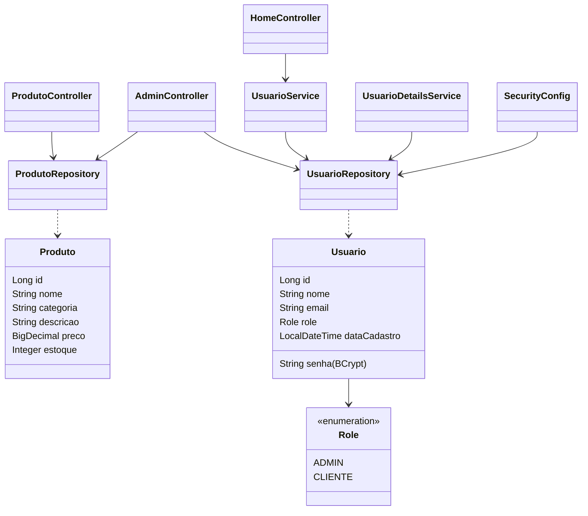

---

## 🗄️ Modelo de dados

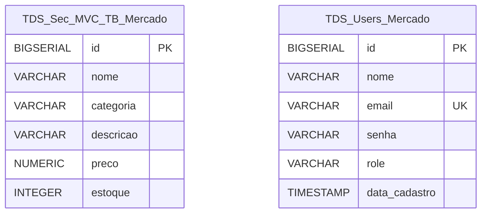

As tabelas são criadas pelo Hibernate (`ddl-auto: update`). Configuração do banco em `application.yml`:

```yaml
spring:
  datasource:
    url: ${DB_URL:jdbc:postgresql://localhost:5433/mercado_sec}
    username: ${DB_USER:mercado}
    password: ${DB_PASSWORD:mercado123}
  jpa:
    hibernate:
      ddl-auto: update
```

Em produção os valores vêm de variáveis de ambiente do Render (`DB_URL`, `DB_USER`, `DB_PASSWORD`).

---

## 🔐 Segurança: login, Sign Up e perfis

Toda a configuração fica em [`SecurityConfig.java`](src/main/java/br/com/fiap/mercado/config/SecurityConfig.java):

```java
http
    .authorizeHttpRequests(auth -> auth
        .requestMatchers("/", "/index", "/login", "/cadastro", "/css/**", "/img/**", "/error").permitAll()
        .requestMatchers("/admin/**", "/produtos/novo", "/produtos/salvar",
                         "/produtos/*/editar", "/produtos/*/excluir").hasRole("ADMIN")
        .anyRequest().authenticated()
    )
    .formLogin(form -> form
        .loginPage("/login")                 // tela de login própria (não a padrão do Spring)
        .usernameParameter("email")
        .passwordParameter("senha")
        .successHandler(redirecionarPorPerfil())
        .failureHandler(falhaNoLogin(usuarioRepository))
    )
    .logout(logout -> logout.logoutUrl("/logout").logoutSuccessUrl("/login?logout"))
    .exceptionHandling(ex -> ex.accessDeniedPage("/acesso-negado"));
```

**Como funciona a tela de login:**

1. A tela `/login` (`templates/login.html`) é **nossa**, não a página padrão do Spring Security. O formulário envia `email` e `senha` (com token CSRF) para `POST /login`.
2. O Spring Security chama o `UsuarioDetailsService`, que busca o usuário na tabela **`TDS_Users_Mercado`** e compara a senha com o hash **BCrypt**.
3. **Login OK:** o `successHandler` redireciona por perfil. **ADMIN** vai para `/admin` e **CLIENTE** vai para `/produtos`.
4. **Login falhou:** o `failureHandler` verifica se o e-mail existe:
   - **e-mail sem cadastro**: redireciona para a tela de **Sign Up** (`/cadastro?semConta&email=...`), já com o e-mail preenchido;
   - **e-mail existe**: senha errada, volta para `/login?error`.
5. No cadastro, o usuário é salvo em `TDS_Users_Mercado` com perfil **CLIENTE** e senha criptografada. Depois ele faz login normalmente.
6. Se um CLIENTE tentar abrir uma rota de ADMIN, recebe a página **Acesso negado** (HTTP 403).

**Perfis (2 tipos de usuário):**

| Recurso | Anônimo | CLIENTE | ADMIN |
|---|:---:|:---:|:---:|
| `index.html` (landing page), login, cadastro | ✅ | ✅ | ✅ |
| Listar / consultar / ver detalhe de produtos | ❌ (vai pro login) | ✅ | ✅ |
| Criar, editar e excluir produtos | ❌ | ❌ (403) | ✅ |
| Painel admin e gestão de usuários/perfis | ❌ | ❌ (403) | ✅ |

---

## 🧭 Endpoints e rotas

| Método | Rota | Acesso | Descrição |
|---|---|---|---|
| GET | `/` | público | Landing page (`index.html`) |
| GET | `/login` | público | Tela de login customizada |
| POST | `/login` | público | Autenticação (Spring Security) |
| GET/POST | `/cadastro` | público | Sign Up de novo cliente |
| POST | `/logout` | logado | Sair |
| GET | `/produtos?busca=` | CLIENTE/ADMIN | **READ**: lista e consulta produtos no PostgreSQL |
| GET | `/produtos/{id}` | CLIENTE/ADMIN | **READ**: detalhe do produto |
| GET | `/produtos/novo` | ADMIN | Formulário de novo produto |
| GET | `/produtos/{id}/editar` | ADMIN | Formulário de edição |
| POST | `/produtos/salvar` | ADMIN | **CREATE / UPDATE** |
| POST | `/produtos/{id}/excluir` | ADMIN | **DELETE** |
| GET | `/admin` | ADMIN | Painel com indicadores |
| GET | `/admin/usuarios` | ADMIN | Lista de usuários (`TDS_Users_Mercado`) |
| POST | `/admin/usuarios/{id}/perfil` | ADMIN | Alterna o perfil ADMIN ⇄ CLIENTE |

---

## 📸 Passo a passo com prints

### 1. Landing page (`index.html`)
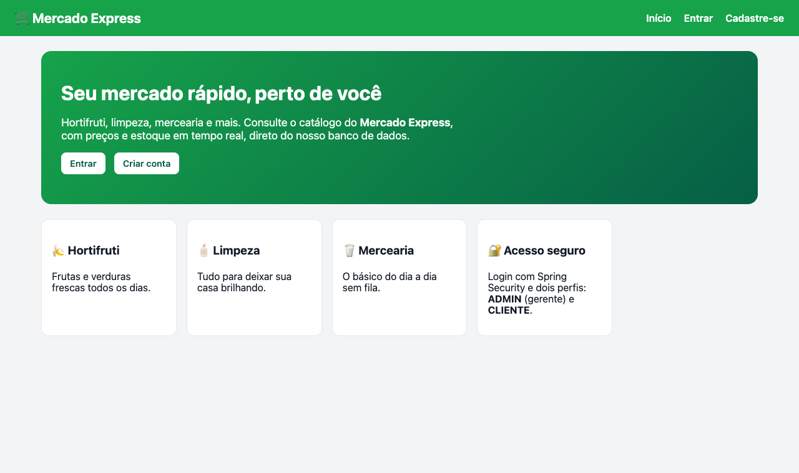

### 2. Tela de login customizada
Tela própria, diferente da tela padrão do Spring Security.
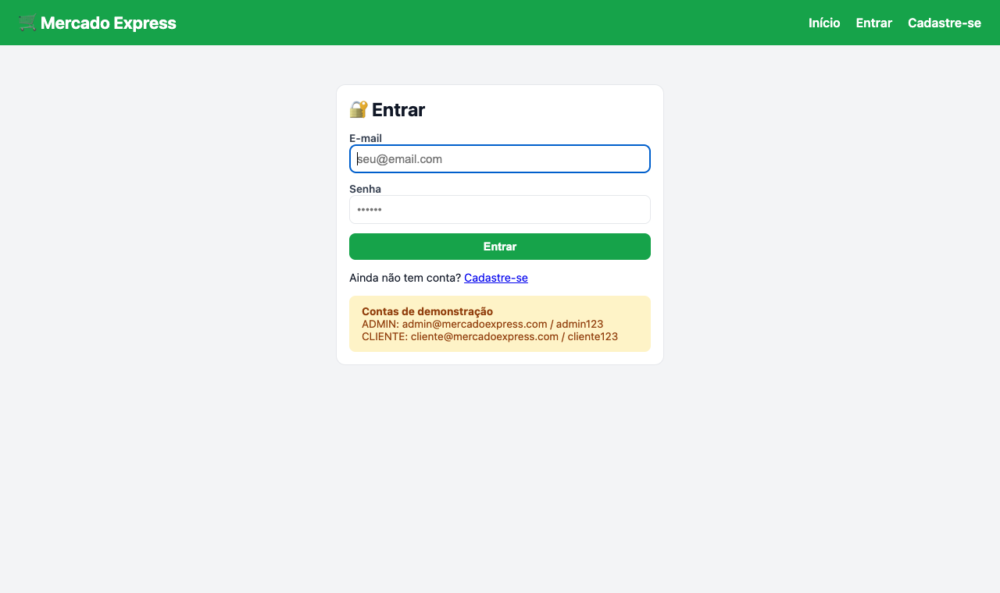

### 3. Usuário sem conta é redirecionado para o Sign Up
Tentamos entrar com `maria@email.com`, que não existe. O sistema redireciona para o cadastro com o e-mail já preenchido.
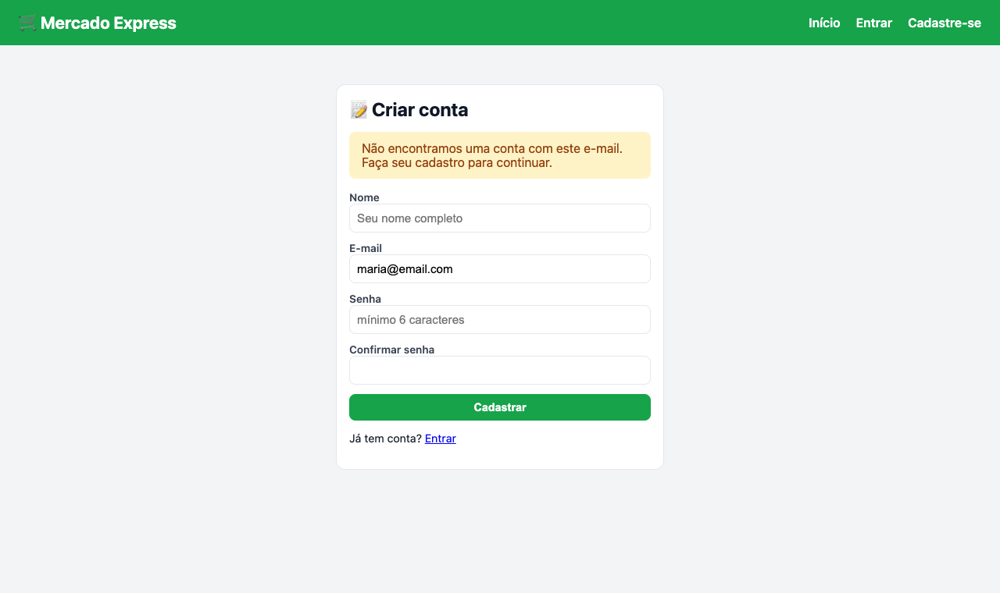

### 4. Cadastro concluído, volta para o login
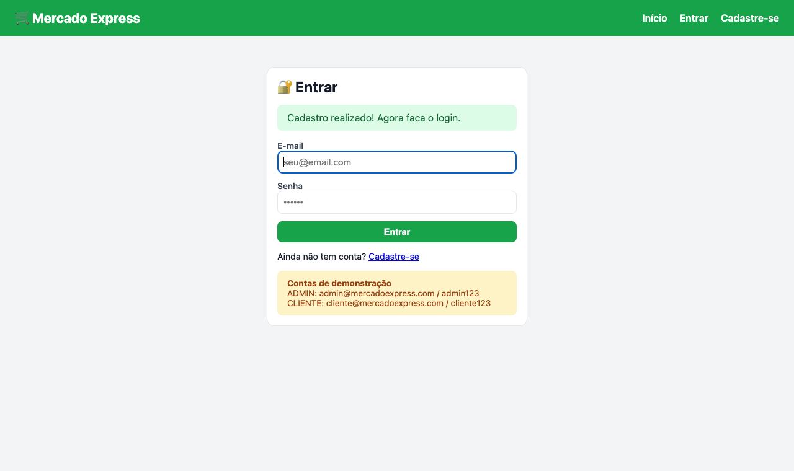

### 5. CLIENTE logado: só consulta (sem botões de editar/excluir)
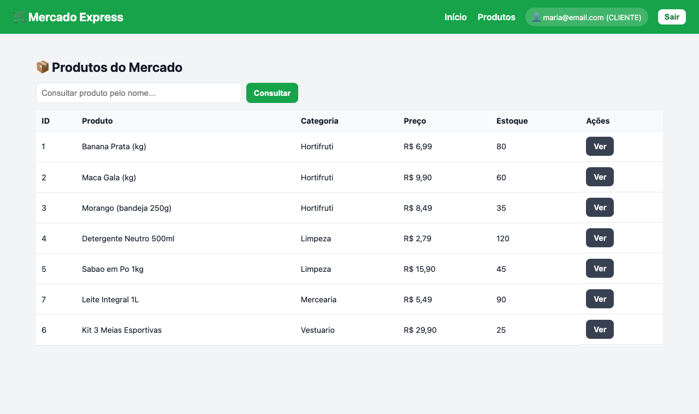

### 6. CLIENTE tentando acessar rota de ADMIN (`/produtos/novo`): acesso negado
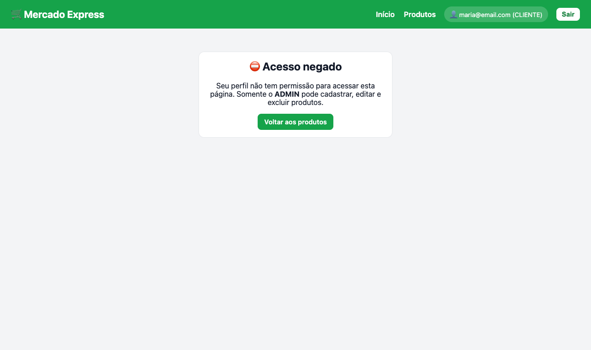

### 7. ADMIN logado é redirecionado para o painel restrito
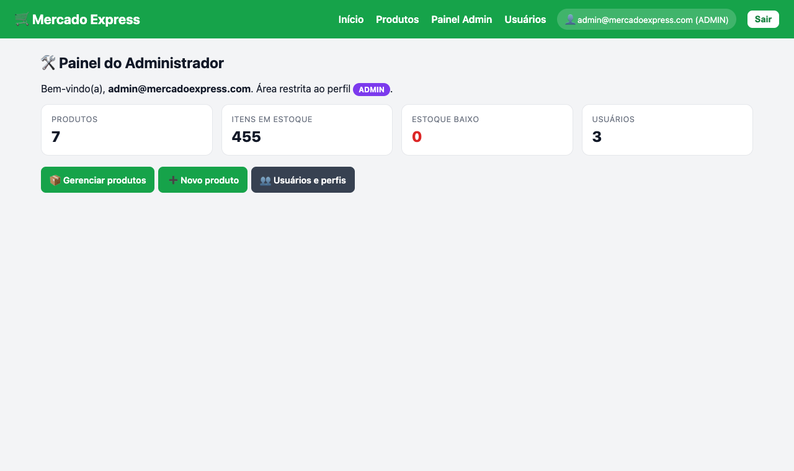

### 8. Lista de produtos com os botões do CRUD (ADMIN)
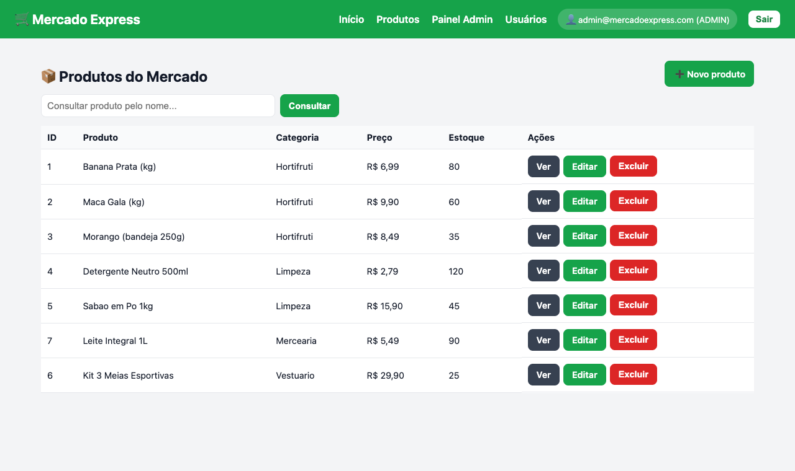

### 9. CREATE: novo produto
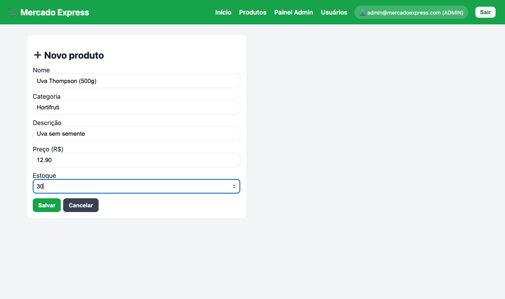
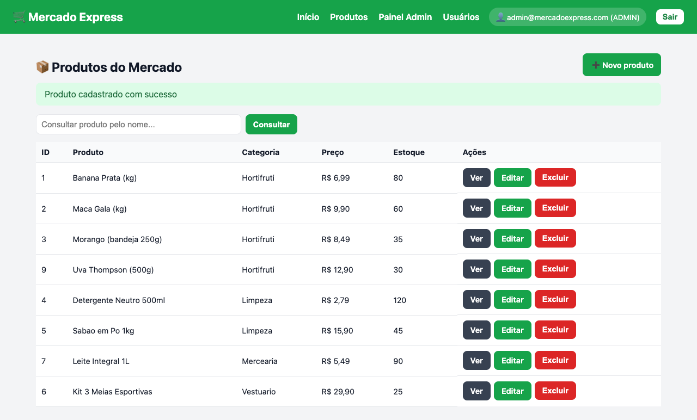

### 10. READ: consulta de produto no PostgreSQL
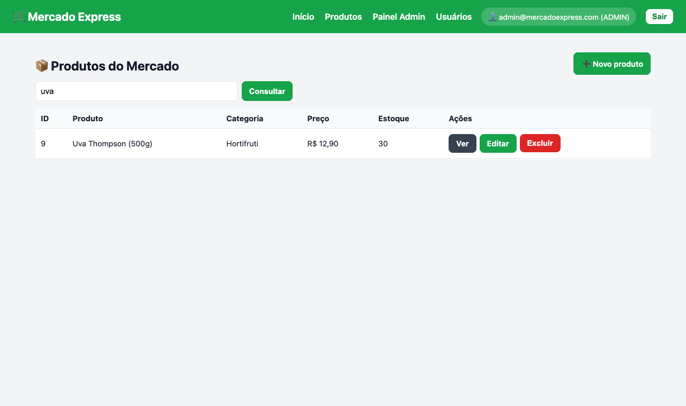

### 11. UPDATE: edição
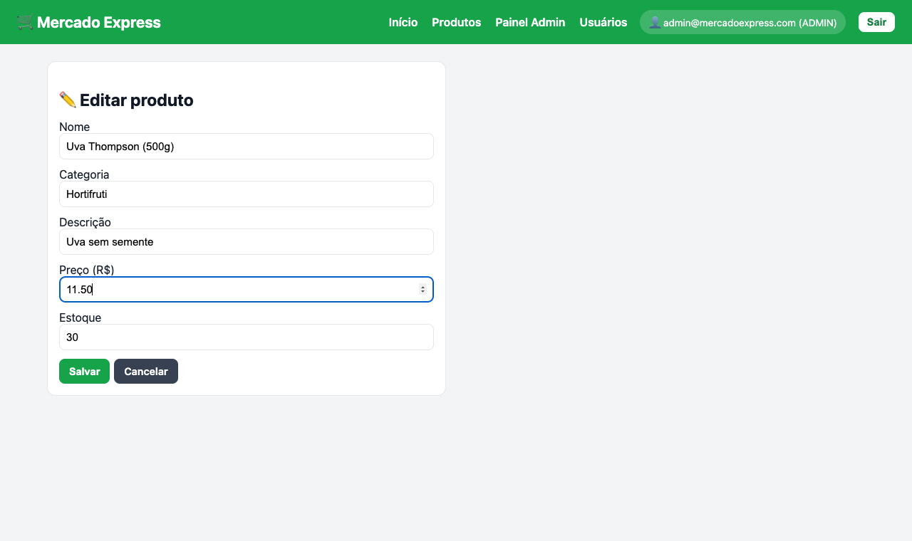

### 12. Usuários e perfis (tabela `TDS_Users_Mercado`)
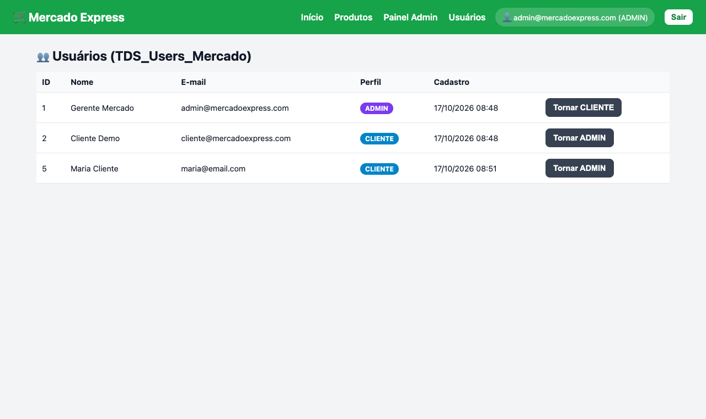

### 13. DELETE: produto excluído
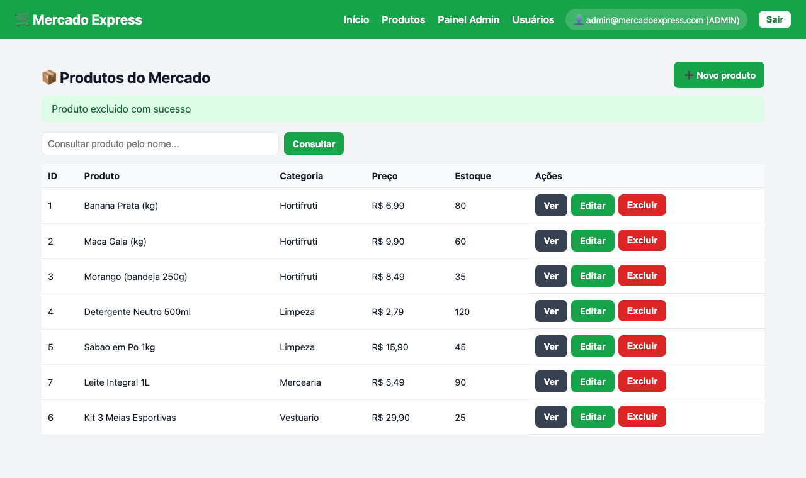

---

## ▶️ Como executar localmente

Pré-requisitos: Java 21, Maven e Docker.

```bash
# 1. Subir um PostgreSQL
docker run -d --name postgres-mercado -e POSTGRES_DB=mercado_sec -e POSTGRES_USER=mercado \
  -e POSTGRES_PASSWORD=mercado123 -p 5433:5432 postgres:16-alpine

# 2. Rodar a aplicação
mvn spring-boot:run

# 3. Acessar
http://localhost:8080
```

No IntelliJ: abrir a pasta do projeto e executar `MercadoExpressSecurityApplication`.

---

## ☁️ Deploy no Render

O deploy usa **Render Blueprint** ([`render.yaml`](render.yaml)) com um [`Dockerfile`](Dockerfile) multi-stage (build Maven, depois runtime JRE 21):

1. No Render: **New + → Blueprint →** selecionar este repositório **→ Apply**.
2. O Render cria sozinho o **PostgreSQL** (`mercado-express-db`, plano free) e o **Web Service Docker** (`mercado-express-security`, plano free).
3. As variáveis `DB_HOST`, `DB_PORT`, `DB_NAME`, `DB_USER` e `DB_PASSWORD` são injetadas a partir do banco criado. O container monta a URL JDBC (`DB_URL`) na inicialização.
4. O Render define a variável `PORT`, e a aplicação usa `server.port: ${PORT:8080}`.
5. Cada `git push` na branch `main` gera um novo deploy automático.
